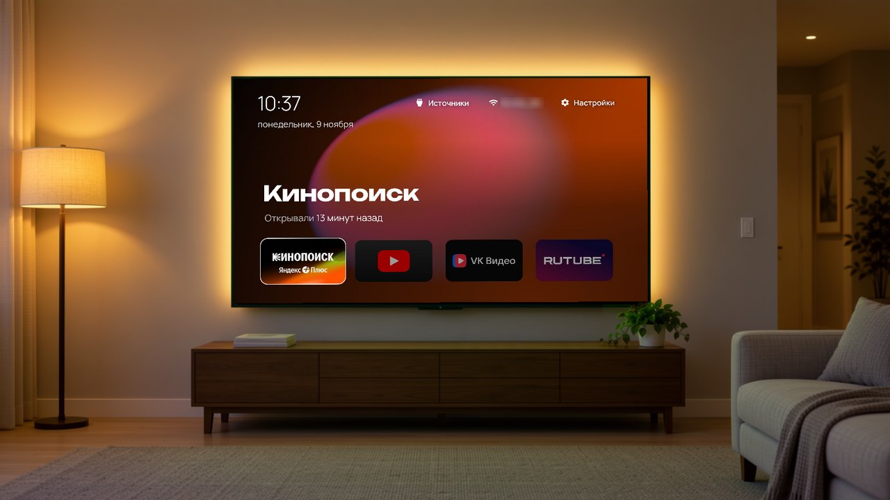
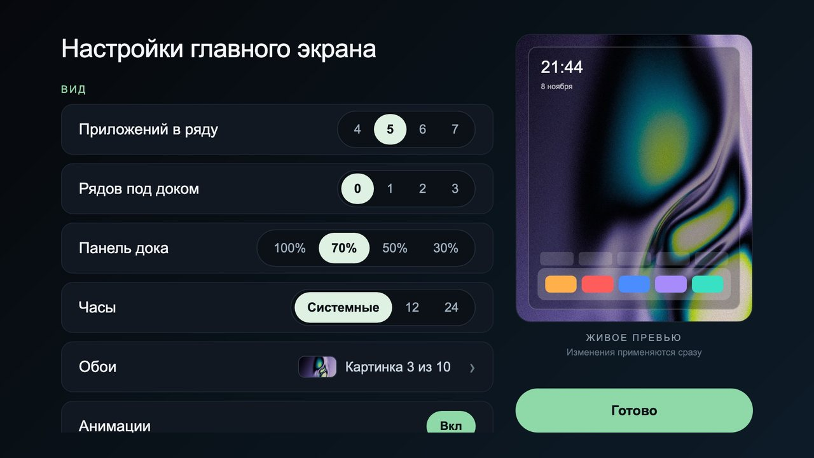
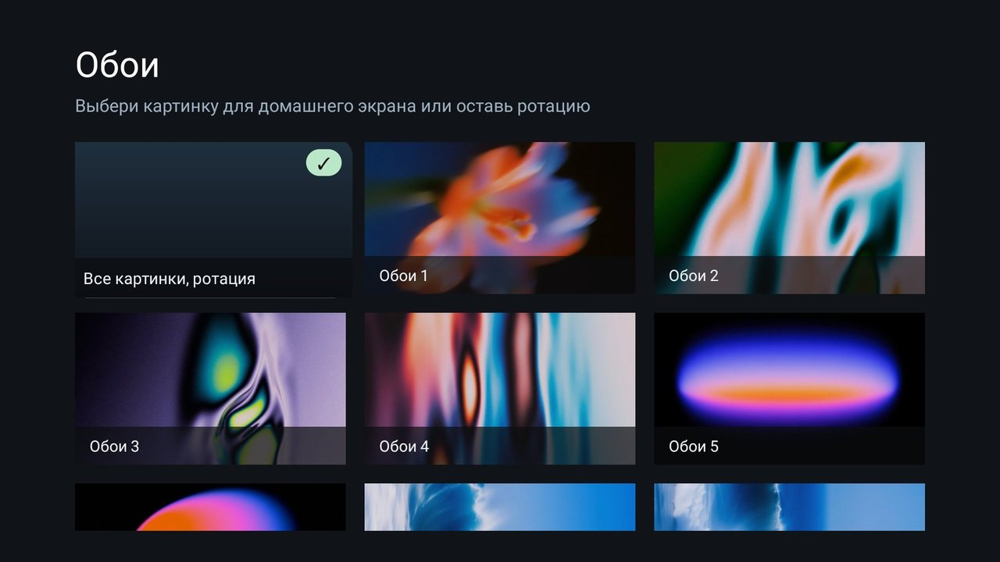

# CleanHome: свой главный экран для Android TV

Лаунчер (главный экран телевизора) в стиле Apple TV: часы, крупная «сцена» с названием выбранного приложения,
док любимых приложений, свои обои с превью и плавная подсветка. Без рекламы, рекомендаций и баннеров.

Это моя сборка открытого проекта [CleanYourTV](https://github.com/Gathin23/cleanyourtv) (MIT). Я не писал код
руками: всё сделали ИИ-агенты (DeepSeek Harness и Claude Code) по моим просьбам за три вечера.
Работает у меня на двух телевизорах:

- **Tuvio STV-43FDUBK1R**: Android 9, 1,5 ГБ памяти по паспорту. Старенький, и с CleanHome он стал заметно шустрее.
- **Яндекс ТВ Станция MiniLED**: Android 14 (YaOS). Отладка у неё закрыта, лаунчер ставится через браузер телевизора.



## 🚀 Установка одним промптом

Ставить руками не нужно. Откройте Claude Code, Codex или другого ИИ-агента на компьютере, который подключён к той
же Wi-Fi сети, что и телевизор, и вставьте:

```text
Установи мне лаунчер CleanHome на телевизор: https://github.com/ungurenko/cleanhome-tv
Прочитай AGENTS.md в репозитории и действуй по нему.
Телевизор: <марка и модель>, он в той же Wi-Fi сети, что и этот компьютер.
Я не программист: объясняй простыми словами, что нажимать на пульте.
```

Агент скачает готовый файл, найдёт телевизор в сети, выберет способ установки и подскажет, какие кнопки нажать на
пульте. Подробная инструкция для агента лежит в [AGENTS.md](AGENTS.md).

## Что добавлено к оригиналу

- **Экран «Сцена»**: крупное название выбранного приложения на фоне обоев, под ним «Открывали 13 минут назад».
- **Шрифты с кириллицей** (Manrope, Unbounded) и док по умолчанию с привычными сервисами: Кинопоиск, YouTube,
  VK Видео, RUTUBE.
- **Обои с превью**: экран выбора с миниатюрами и пункт «Обои» прямо в меню настроек (удерживайте «Настройки»).
- **Новый экран настроек** с живым предпросмотром главного экрана.
- **Имя Wi-Fi сети** на главном экране вместо значка.
- **Быстрый холодный запуск**: на Tuvio лаунчер открывается за 0,68 с вместо 1,05 с. Все замеры в
  [PERFORMANCE-REVIEW.md](PERFORMANCE-REVIEW.md).
- **Встроенный счётчик кадров** в меню настроек, чтобы проверить плавность на своём телевизоре.
- **6 обоев**, нарисованных локальной нейросетью MOSS-Image специально для этой версии.


| Настройки | Выбор обоев |
|---|---|
|  |  |

## Как вернуть родной экран

Всё обратимо. Удалите приложение «Главный экран» в настройках телевизора (Приложения → «Главный экран» → Удалить),
и родной экран вернётся. Прошивка телевизора не меняется.

## Своими руками, без агента

1. Скачайте `CleanHome-*.apk` со страницы [Releases](https://github.com/ungurenko/cleanhome-tv/releases/latest).
2. **Если на телевизоре включается отладка по сети**: `adb connect <ip-телевизора>:5555`, затем
   `adb install -r CleanHome-*.apk` и `adb shell cmd package compile -m speed -f com.gathin.tvhome` (ускоряет запуск).
3. **Если отладка закрыта** (например, Яндекс ТВ Станции): `python3 scripts/serve-apk.py CleanHome-*.apk`, откройте
   показанный адрес в браузере телевизора, скачайте и установите файл.
4. Откройте «Главный экран» и разрешите ему стать главным экраном.

## Меняйте под себя

Главная идея: это ваш экран. Скажите агенту, что хотите поменять, например «поставь мои фото в обои», «добавь
в док Okko» или «сделай часы крупнее». Он поправит код, соберёт новую версию и поставит её на телевизор. Как
устроены настройки и сборка, агент прочитает в [AGENTS.md](AGENTS.md).

## Лицензии и благодарности

- Код: MIT, как и оригинальный [CleanYourTV](https://github.com/Gathin23/cleanyourtv) от Gathin. Текст в [LICENSE](LICENSE).
- Шрифты Outfit, Manrope, Unbounded: SIL Open Font License 1.1, [FONT-LICENSE-OFL.txt](FONT-LICENSE-OFL.txt).
- Иконки праздничных тем: Microsoft Fluent Emoji (MIT), [ICONS-LICENSE-FLUENT-EMOJI.txt](ICONS-LICENSE-FLUENT-EMOJI.txt).
- Названия и логотипы сервисов принадлежат их владельцам.

---

**English.** CleanHome is a personal fork of the CleanYourTV Android TV launcher, built entirely by AI coding agents:
an Apple TV style «Scene» home, Cyrillic fonts, a wallpaper picker with previews, a settings screen with a live
preview and a 35% faster cold start on a 1.5 GB Android 9 TV. To install, paste the prompt above into Claude Code or
Codex; the agent follows [AGENTS.md](AGENTS.md) and installs over ADB, or through the TV browser where ADB is locked.
